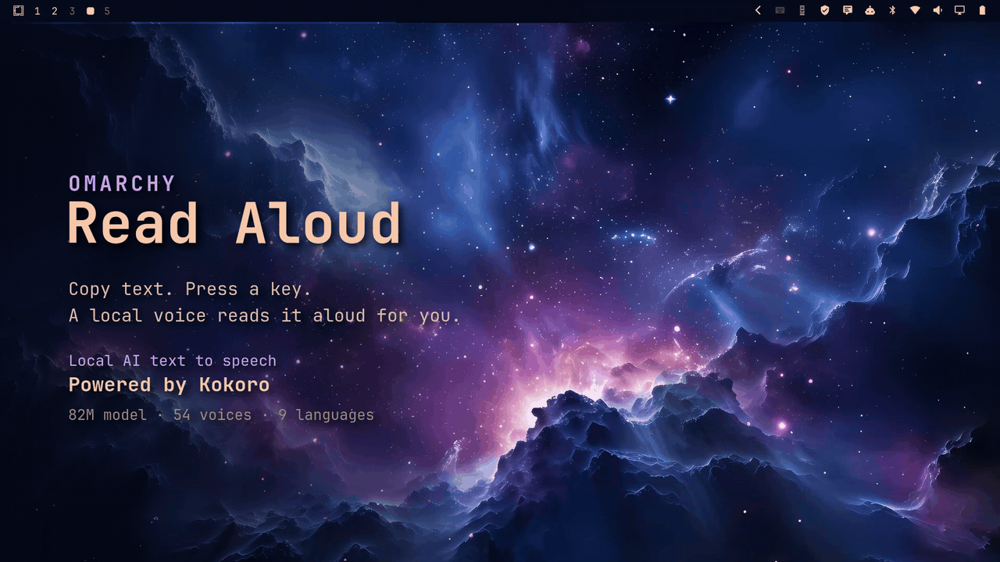

# Read Aloud: Text to Speech

Text to speech (TTS) for the [Omarchy](https://omarchy.org) bar. Read aloud any text you copy with a local AI voice ([Kokoro](https://huggingface.co/hexgrad/Kokoro-82M)). 54 voices, 9 languages, works offline after setup. Helps with dyslexia and long reads.

Powered by Kokoro: [GitHub](https://github.com/hexgrad/kokoro) · [🤗 Hugging Face](https://huggingface.co/hexgrad/Kokoro-82M)


## Controls

- **Left-click** the speech bubble: read the clipboard. Click again to stop.
- **Right-click**: pick a voice, switch male or female, and open Settings for speed, language and keys.
- While a voice is getting ready, the icon turns into a spinning ring. While it reads, it shows a stop square.

Picking a voice plays a short sample. Choices are saved and apply to every read.

## Keybind

Add a toggle to `~/.config/hypr/bindings.lua`. This one fires on a tap of AltGr + Right Ctrl:

```lua
o.bind("CTRL + ALT + Control_R", "Read clipboard aloud / stop", '$HOME/.local/share/omarchy-say/say --clip', { release = true })
o.bind("CTRL + ALT + Alt_R", "Read clipboard aloud / stop", '$HOME/.local/share/omarchy-say/say --clip', { release = true })
```

## First run

The first click sets up the voice by itself: Python 3.12 and the Kokoro engine through `uv`, then the 350 MB voice model, checked against fixed SHA-256 hashes. A progress bar shows in the panel, and it says "Voice ready" when done. Everything lands in `~/.local/share/omarchy-say/`.

Needs `uv`, PipeWire (`pw-play`) and wl-clipboard (`wl-paste`). Omarchy ships all three.

## For agents

`skills/read-aloud/SKILL.md` is a Claude Code skill: when you ask your agent to read something to you, it writes a speakable version and plays it through this engine instead of pasting a wall of text. Link it in:

```bash
ln -s "$PWD/skills/read-aloud" ~/.claude/skills/read-aloud
```

## Install

```bash
omarchy plugin add https://github.com/remigius-labs/omarchy-read-aloud --enable
```

## Remove

```bash
omarchy plugin remove remi.say
rm -rf ~/.local/share/omarchy-say
```

The second line deletes the voice engine and model (about 350 MB).

## Limits

- Kokoro has English (US, UK), Portuguese, Spanish, French, Japanese, Italian, Mandarin and Hindi.
- First sound takes about a second on a laptop CPU.

## Preview


### How it works

Copy text, tap the key, and it reads it out.



## License

MIT. Kokoro model weights are Apache 2.0. Packages the setup installs keep their own licenses: kokoro-onnx and onnxruntime (MIT), phonemizer and espeak-ng (GPL-3).
