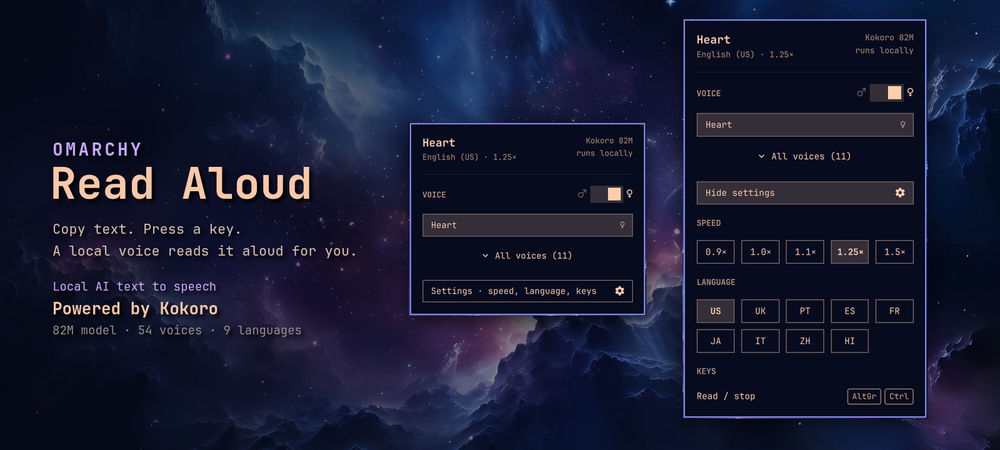

# Read Aloud

Local AI text to speech for the [Omarchy](https://omarchy.org) bar. Copy text, press a key, and a local [Kokoro](https://huggingface.co/hexgrad/Kokoro-82M) voice reads it aloud. Everything runs on your machine.



## Preview


## Controls

- **Left-click** the speech bubble: read the clipboard. Click again to stop.
- **Right-click**: pick a voice, switch male or female, and open Settings for speed, language and keys.
- While a voice is getting ready, the icon turns into a spinning ring. While it reads, it shows a stop square.

Picking a voice plays a short sample. Choices are saved and apply to every read.

## Keybind

Add a toggle to `~/.config/hypr/bindings.lua`. This one fires on a tap of AltGr + Right Ctrl:

```lua
o.bind("CTRL + ALT + Control_R", "Read clipboard aloud / stop", '$HOME/.local/share/omarchy-say/say --clip', { release = true })
o.bind("CTRL + ALT + Alt_R", "Read clipboard aloud / stop", '$HOME/.local/share/omarchy-say/say --clip', { release = true })
```

## Requirements

The widget drives a small speech engine (Python, `kokoro-onnx`, about 350 MB of model files). It looks for it in `~/.local/share/omarchy-say/`; point it elsewhere with:

```bash
omarchy bar set remi.say engineDir /path/to/engine
```

The engine needs `pw-play` (PipeWire) and `wl-paste` (wl-clipboard).

## Install

```bash
omarchy plugin add https://github.com/remigius-labs/omarchy-read-aloud --enable
```

## Remove

```bash
omarchy plugin remove remi.say
```

## Limits

- The speech engine is not bundled yet; this repo holds the bar widget.
- Kokoro has English (US, UK), Portuguese, Spanish, French, Japanese, Italian, Mandarin and Hindi. No Dutch or German.
- First sound takes about a second on a laptop CPU.

## License

MIT. Kokoro model weights are Apache 2.0.
